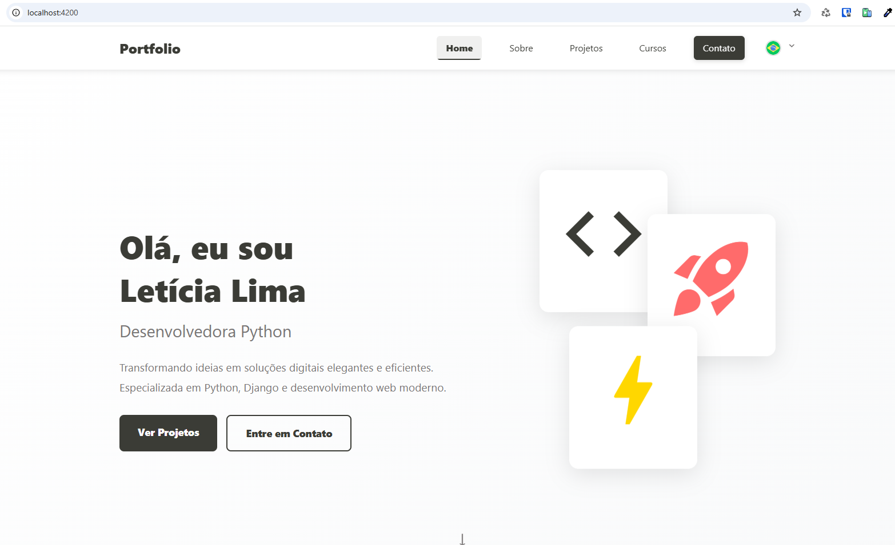

# Portfolio

<p align="center">
  
</p>

A personal portfolio application built with Angular 20 to showcase projects, courses, professional experience, and contact options in a modern, responsive, multilingual interface.

## Overview

The project was built with standalone components, lazy-loaded pages, and local JSON-based data. The application also includes language switching and a contact form integrated with EmailJS.

## Features

- Home page with personal introduction and professional highlights
- "About" section with profile summary and skills
- Dynamic project listing from `src/assets/json/projects.json`
- Dynamic course listing from `src/assets/json/courses.json`
- Dedicated thesis page with videos and PDFs
- Contact form powered by EmailJS
- Support for Portuguese, English, and Spanish
- Responsive layout for desktop and mobile

## Application routes

- `/` - Home
- `/about` - About
- `/projects` - Projects
- `/courses` - Courses
- `/tcc` - Thesis
- `/contact` - Contact

## Technologies

- Angular 20
- TypeScript
- SCSS
- Angular Material
- RxJS
- EmailJS

## How to run

### Prerequisites

- Node.js installed
- npm installed

### Installation

```bash
npm install
```

### Development environment

```bash
npm start
```

Then open `http://localhost:4200/`.

## Available scripts

```bash
npm start
npm run build
npm run build:prod
npm run watch
npm test
npm run lint
```

## Main structure

```text
src/
  app/
    components/   # reusable components
    pages/        # main application pages
    services/     # local API, language, and helpers
  assets/
    json/         # project and course data
    icon/         # flags and icons
    logo/         # portfolio images
    videos/       # videos used on the thesis page
doc/
  preview.png     # image used in the README
```

## Customization

- Update projects in `src/assets/json/projects.json`
- Update courses in `src/assets/json/courses.json`
- Adjust text content in `src/app/services/language/translations.ts`
- Configure EmailJS keys in `src/environments/`

### Editing projects

The Projects page reads `src/assets/json/projects.json`. Each item needs a unique
`ID` and a `category`:

- `system` for an application with a defined workflow;
- `example` for a tutorial or focused code example;
- `academic` for an academic project (shown with Systems in the filter).

The order of items in the JSON file is the order shown on the page. `name` and
`description` contain `pt`, `en`, and `es` text; `label` and `tags` describe the
technologies. Edit the JSON and rebuild the site to publish content changes.

## Build and deploy

To generate the production build:

```bash
npm run build:prod
```
